<div align="center">
  

  <h1>Verana Visualizer</h1>

  <p>A live 3D map of the Verana trust network. Every star, orbit and comet comes from the chain.</p>

  <p>
    <a href="https://vis.testnet.verana.network"></a>
    <a href="https://vis.devnet.verana.network"></a>
  </p>
  <p>
    <a href="https://docs.verana.io/docs/build/run-infrastructure/visualizer"></a>
    <a href="https://github.com/verana-labs/verana-spec/tree/main/v4/verana-visualizer"></a>
  </p>

  <a href="https://github.com/verana-labs/verana-visualizer/actions/workflows/ci.yml"></a>
  <a href="https://github.com/verana-labs/verana-visualizer/releases"></a>
  <a href="LICENSE"></a>
  <br />
  <a href="https://nodejs.org/en"></a>
  <a href="https://nextjs.org/"></a>
  <a href="https://react.dev/"></a>
  <a href="https://r3f.docs.pmnd.rs/"></a>
  <a href="https://www.typescriptlang.org/"></a>
  <a href="https://tailwindcss.com/"></a>
  <br />
  <a href="#docker"></a>
  <a href="#helm"></a>
  <a href="https://discord.gg/edjaFn252q"></a>
</div>

<br />

<p align="center">
  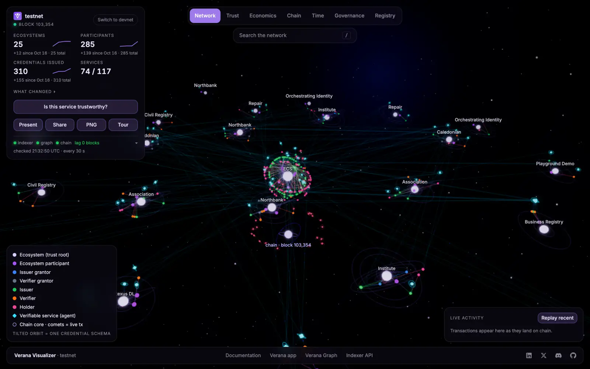
</p>

<p align="center">
  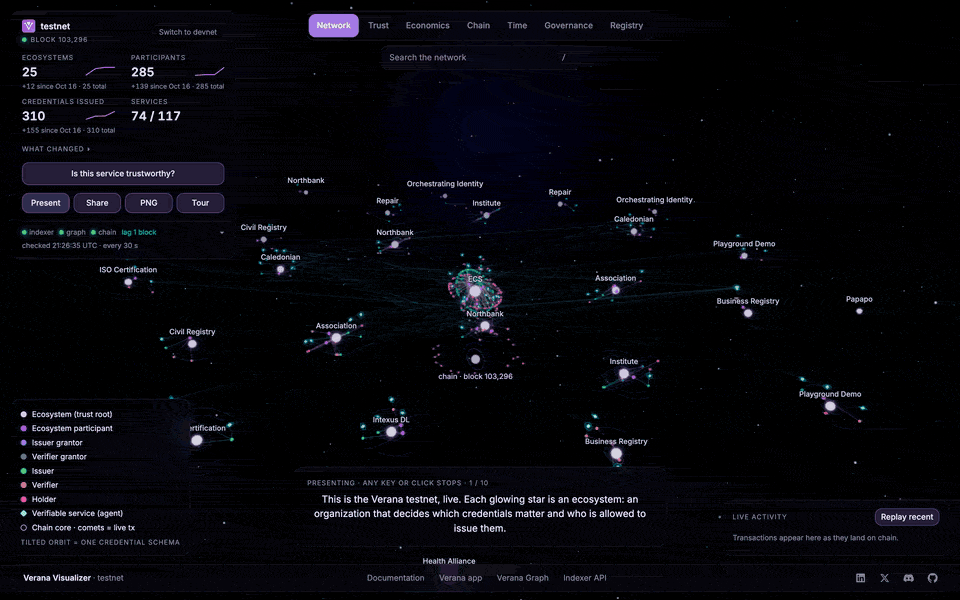
  <br />
  <sub>Present mode on testnet, recorded live. No sped-up footage, no fake data.</sub>
</p>

## What it is

Verana is a public network where organisations publish who they trust: which ecosystems exist, who is accredited to issue or verify which credential, and which services are behind them. That information lives on a blockchain and is hard to picture from raw API calls.

The visualizer turns it into a place you can fly around. Each ecosystem is a star, its participants orbit around it, and transactions leave the chain core as comets the moment they land. You can switch between seven views of the same data, click anything to see where its numbers come from, check whether a service is trusted, and share a link to exactly what you are looking at.

It reads everything from the indexer, the REST API and the RPC of the network it is pointed at. If a call fails, the UI says so instead of showing zeros.

## Contents

- [Features](#features)
  - [The 3D network](#the-3d-network)
  - [Seven lenses](#seven-lenses)
  - [Is this service trustworthy?](#is-this-service-trustworthy)
  - [Inspector](#inspector)
  - [Time scrubbing and replay](#time-scrubbing-and-replay)
  - [Tour, Present, Share and PNG](#tour-present-share-and-png)
  - [Health](#health)
  - [Nothing is simulated](#nothing-is-simulated)
- [Quick start](#quick-start)
- [Configuration](#configuration)
- [Docker](#docker)
- [Helm](#helm)
- [Testing](#testing)
- [Releases](#releases)
- [Project structure](#project-structure)
- [Contributing](#contributing)
- [License and community](#license-and-community)

## Features

### The 3D network

The default view is a galaxy. Each ecosystem is a glowing star, sized by its participant count. Participants circle it on tilted orbits, one orbit per credential schema, and the further out an orbit sits the deeper it is in the chain of accreditation. Colours follow the role (ecosystem, issuer grantor, verifier grantor, issuer, verifier, holder) and verifiable services are drawn as cyan diamonds. The chain core sits under the galaxy and each live transaction leaves it as a comet.

The HUD shows the live block, headline counts with sparklines and what changed recently. Search with <kbd>/</kbd> or <kbd>Cmd</kbd>/<kbd>Ctrl</kbd>+<kbd>K</kbd> finds any entity by name, id or DID. Devnet and testnet link to each other, and the switch keeps your current view.

Without WebGL, or if the scene crashes, you get a clickable list of the same entities instead. `prefers-reduced-motion` is respected: comets arrive instantly and lens changes skip the camera flight.

### Seven lenses

Same entities, seven arrangements. The tab bar switches between them and `?lens=` deep-links to one.

<table>
  <tr>
    <td width="50%" valign="top">
      <b>Network</b><br />
      Ecosystems as stars, participants on schema orbits, live comets from the chain core.<br /><br />
      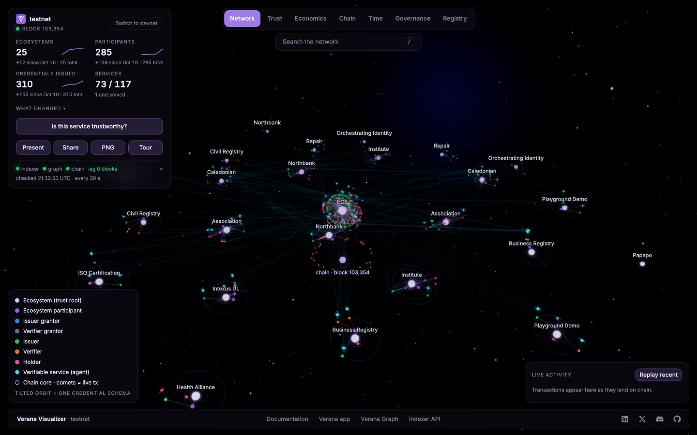
    </td>
    <td width="50%" valign="top">
      <b>Trust</b><br />
      Each ecosystem unfolds into its accreditation tree: grantors, then issuers and verifiers below them.<br /><br />
      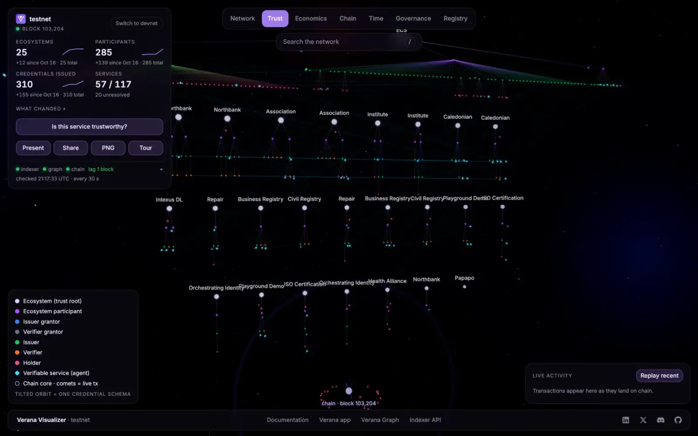
    </td>
  </tr>
  <tr>
    <td valign="top">
      <b>Economics</b><br />
      Nodes resized by trust deposit on a log scale, deposits drawn as glowing reservoirs, plus a what-if fee simulator.<br /><br />
      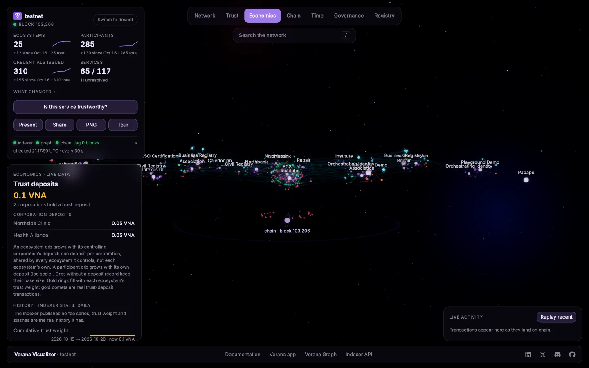
    </td>
    <td valign="top">
      <b>Chain</b><br />
      Validators ring the core, sized by voting power, with the latest blocks stacked above it and live chain stats.<br /><br />
      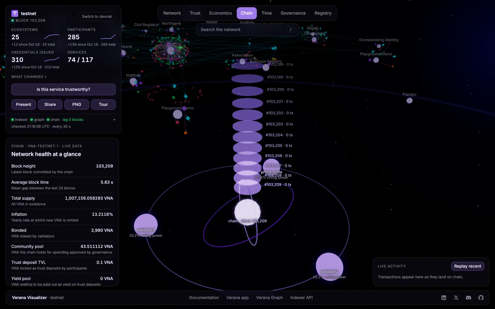
    </td>
  </tr>
  <tr>
    <td valign="top">
      <b>Time</b><br />
      The network rebuilt at any block height, with a density strip of past events to scrub through.<br /><br />
      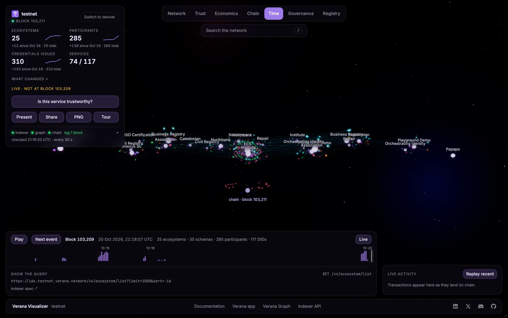
    </td>
    <td valign="top">
      <b>Governance</b><br />
      Corporations as small constellations beside their ecosystems, members sized by voting weight, open proposals pulsing.<br /><br />
      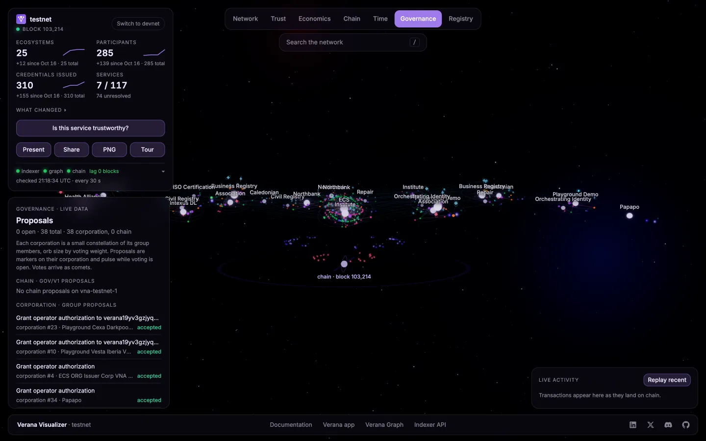
    </td>
  </tr>
  <tr>
    <td valign="top">
      <b>Registry</b><br />
      An onboarding board with one column per participant state, accreditations expiring in the next 30 days, schema coverage and slashes.<br /><br />
      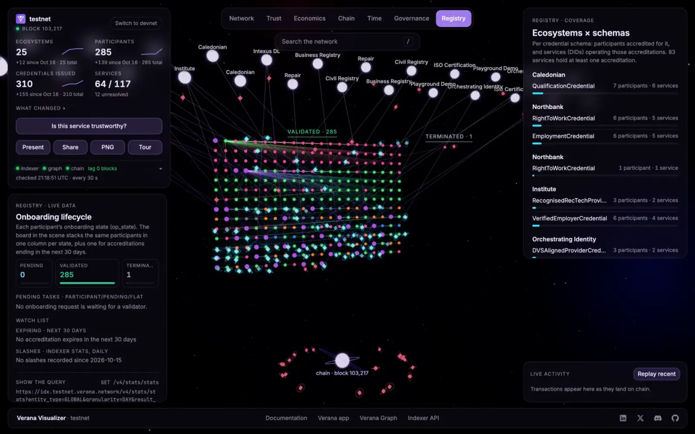
    </td>
    <td valign="top">
      <b>Same app, other network</b><br />
      One image serves any network. Devnet runs with an orange accent, testnet with purple.<br /><br />
      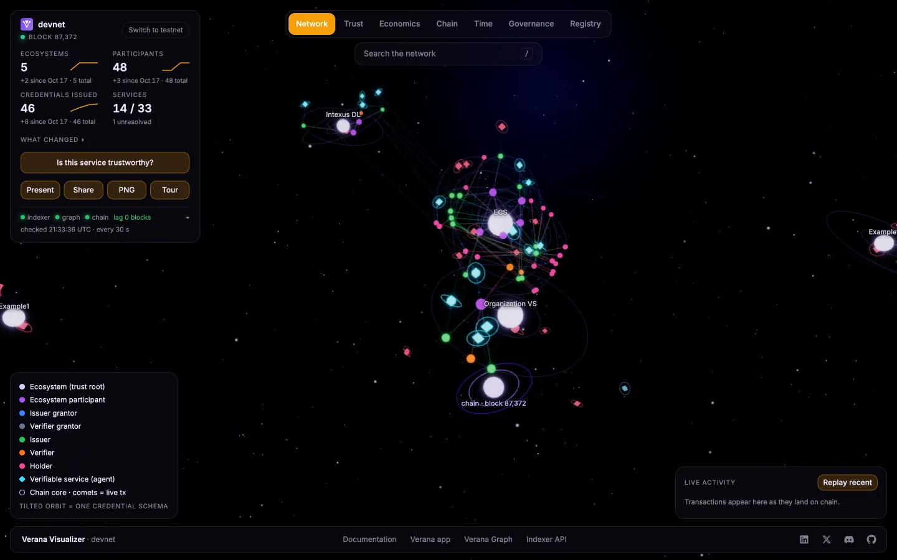
    </td>
  </tr>
</table>

### Is this service trustworthy?

Paste a DID, or search for a service, and the visualizer asks the indexer whether it is trusted (`/v4/verifiable-trust/resolve`). That answer is the only authority. In parallel it walks the accreditation path through verana-graph, falling back to the loaded network if the graph is down, and draws the path hop by hop in the scene: cyan when trusted, rose when not.

Every check has a permalink at `/verdict/<did>?block=<height>`. It is pinned to the block the verdict was evaluated at, renders on the server, and has copy and print buttons, so you can send it to someone or attach it to a ticket.

<table>
  <tr>
    <td width="58%" valign="top">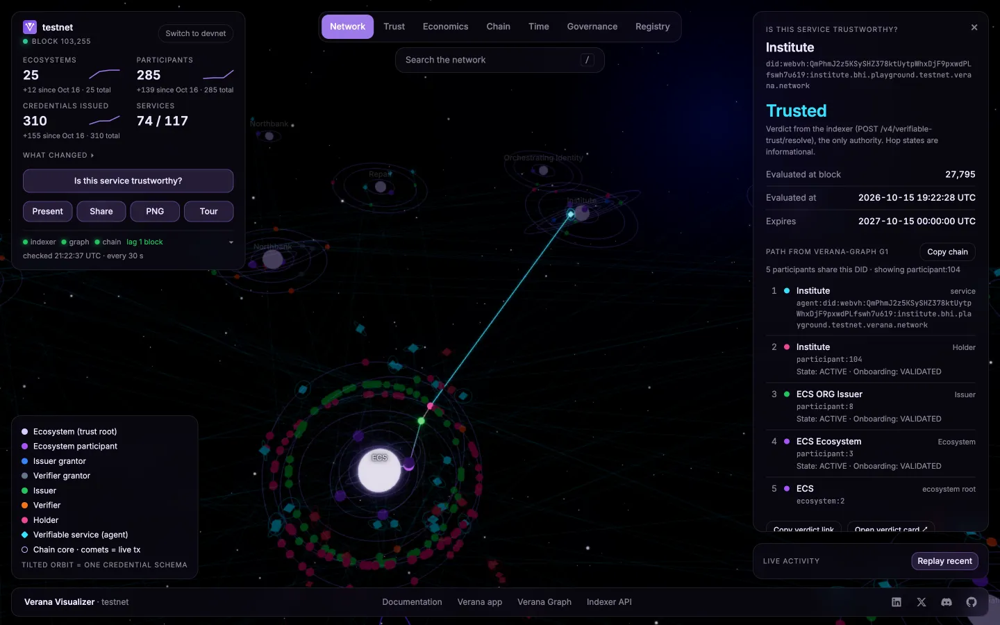</td>
    <td width="42%" valign="top">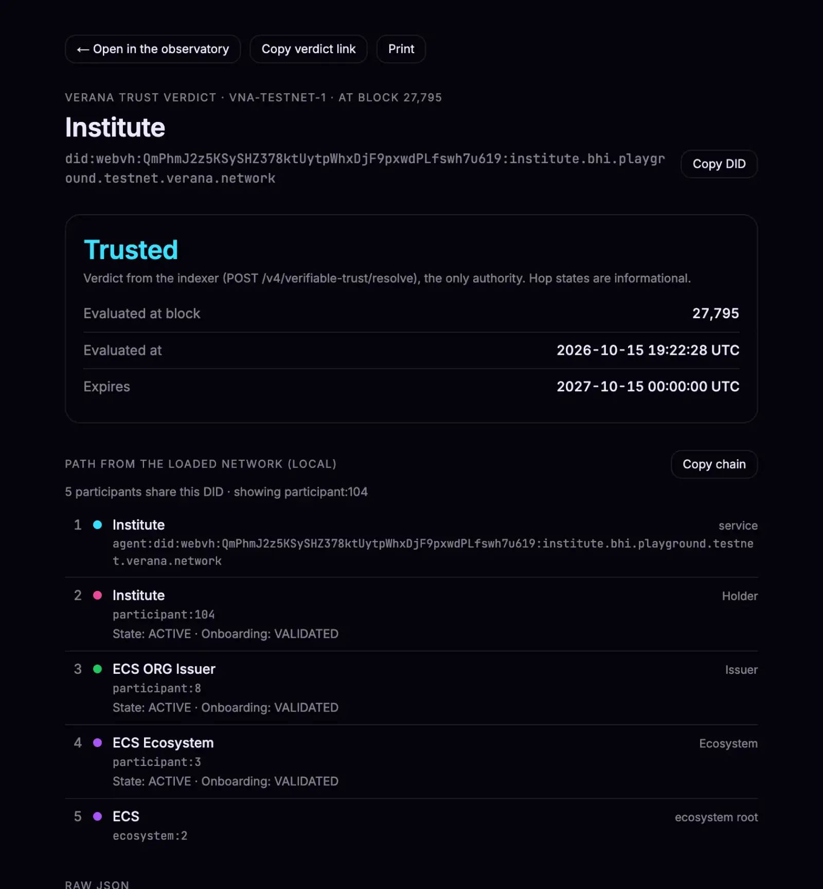</td>
  </tr>
</table>

### Inspector

Click any star, participant, schema, corporation or service to open the inspector: counts, deposits, fees, who accredited whom, and links into the Verana app. Two things make it more than a detail panel:

- "Show the query" displays the exact API call behind the numbers, with a copy-as-`curl` button, and links to the indexer or graph spec for that endpoint.
- Each entity kind links to its section of the VPR v4 spec, so you can read what an ecosystem or a participant is supposed to be.

<p align="center">
  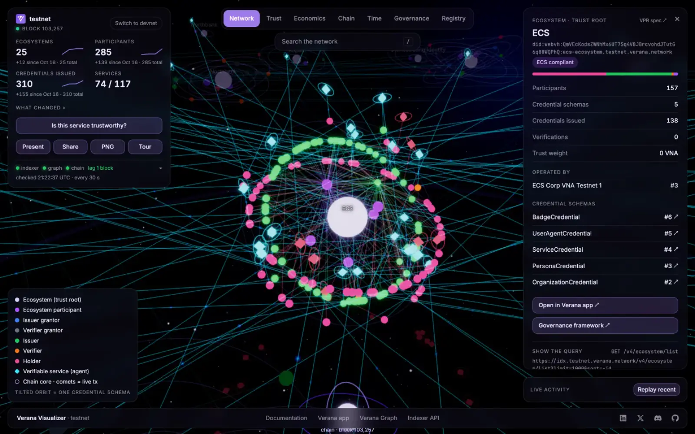
</p>

### Time scrubbing and replay

The Time lens has a block-height scrubber. Drag it, press Play, or jump to the next event, and the network is rebuilt from the indexer as it was at that block. Entities that existed then but are gone now are flagged. "Replay recent" in the activity feed replays the last 30 real events as comets. The live feed itself comes over the indexer websocket.

### Tour, Present, Share and PNG

| Button | What it does |
| --- | --- |
| Tour | 10 steps through the network, the seven lenses, a trust check and the live core. Escape exits. |
| Present | The tour on autopilot for a screen or a booth. It holds on the live core and replays real events there. Any key or click stops it. |
| Share | Copies a link that restores the lens, selection, camera, block, open panel and tour step (`lens`, `sel`, `cam`, `t`, `panel`, `tour`, `q`). |
| PNG | Saves the canvas stamped with chain id, block, UTC time and source, as `verana-<chainId>-block-<height>.png`. |

### Health

`/health` runs live sanity checks against the indexer, the chain and the websocket from the browser and shows each as pass, fail or skipped. `/health?format=json` renders the same report as JSON text in the page once the checks finish; it is a client-rendered page, not a JSON API, so scripts need a browser (the report's `<pre data-testid="health-json">` carries `data-state="done"` when complete). It is the first place to look when a deployment shows an empty scene.

### Nothing is simulated

One rule runs through the whole app: every animation maps to a real, timestamped event with a block height. There is no demo graph, no synthetic traffic, and nothing is invented to fill a quiet chain. The only exception is the what-if fee simulator in the Economics lens, which is labelled Simulation and starts from the live trust deposit parameters.

Old v3 URLs (`/dashboard`, `/governance`, `/e/<kind>/<id>` and so on) redirect to the matching lens or selection.

Spec: [`v4/verana-visualizer/spec.md`](https://github.com/verana-labs/verana-spec/blob/main/v4/verana-visualizer/spec.md) in verana-spec.

## Quick start

Needs Node 24 and pnpm 9.

```bash
pnpm install --frozen-lockfile
cp env.example .env.local   # or export the variables below
pnpm dev
```

Production build:

```bash
pnpm build
pnpm start
```

## Configuration

<details>
<summary>Environment variables, read at runtime so one image serves any network</summary>

<br />

Variables are read at runtime (`next-runtime-env`), so one image serves any network.

| Variable | Required | Notes |
| --- | --- | --- |
| `NEXT_PUBLIC_VERANA_INDEXER_BASE_URL` | yes | indexer root, a trailing `/v4` or `/` is stripped; the websocket URL is derived from it |
| `NEXT_PUBLIC_VERANA_RPC_ENDPOINT` | yes | Tendermint RPC |
| `NEXT_PUBLIC_VERANA_REST_ENDPOINT` | yes | chain REST API |
| `NEXT_PUBLIC_VERANA_CHAIN_ID` | yes | e.g. `vna-testnet-1` |
| `NEXT_PUBLIC_VERANA_CHAIN_NAME` | no | defaults to the network in the indexer host (`idx.<net>.verana.network`), required otherwise |
| `NEXT_PUBLIC_VERANA_GRAPH_URL` | custom hosts only | defaults to `https://graph.<net>.verana.network` |
| `NEXT_PUBLIC_VERANA_FRONTEND_URL` | custom hosts only | defaults to `https://app.<net>.verana.network` |
| `NEXT_PUBLIC_VERANA_PEER_VISUALIZER_URL` | no | network switch target, defaults to `vis.testnet` for devnet and `vis.devnet` for testnet, none for other hosts |

Derivations only apply when the indexer URL matches `idx.<net>.verana.network`. For any other host the graph and frontend URLs must be set explicitly (the app refuses to start without them) and the peer switch is hidden.

Legacy names still work when the primary is unset:

| Primary | Legacy fallback |
| --- | --- |
| `NEXT_PUBLIC_VERANA_INDEXER_BASE_URL` | `NEXT_PUBLIC_IDX_ENDPOINT` |
| `NEXT_PUBLIC_VERANA_RPC_ENDPOINT` | `NEXT_PUBLIC_RPC_ENDPOINT` |
| `NEXT_PUBLIC_VERANA_REST_ENDPOINT` | `NEXT_PUBLIC_API_ENDPOINT` |
| `NEXT_PUBLIC_VERANA_CHAIN_ID` | `NEXT_PUBLIC_CHAIN_ID` |
| `NEXT_PUBLIC_VERANA_CHAIN_NAME` | `NEXT_PUBLIC_CHAIN_NAME` |

See [`env.example`](env.example) for a testnet setup.

</details>

## Docker

<details>
<summary>Build and run the image</summary>

<br />

```bash
docker build --build-arg APP_VERSION=0.0.0-local -t verana-visualizer:local .
docker run --rm -p 3000:3000 \
  -e NEXT_PUBLIC_VERANA_INDEXER_BASE_URL=https://idx.testnet.verana.network \
  -e NEXT_PUBLIC_VERANA_RPC_ENDPOINT=https://rpc.testnet.verana.network \
  -e NEXT_PUBLIC_VERANA_REST_ENDPOINT=https://api.testnet.verana.network \
  -e NEXT_PUBLIC_VERANA_CHAIN_ID=vna-testnet-1 \
  -e NEXT_PUBLIC_VERANA_CHAIN_NAME=testnet \
  verana-visualizer:local
```

The container refuses to start if the indexer, RPC, REST or chain id variable is missing or blank.

</details>

## Helm

<details>
<summary>Deploy to Kubernetes with the chart in <code>charts/</code></summary>

<br />

The chart lives in `charts/`, see [`charts/README.md`](charts/README.md). Network values have no default: pass `values-devnet.yaml`, `values-testnet.yaml` or your own file.

```bash
helm lint charts
helm install vis ./charts -f ./charts/values-testnet.yaml
```

</details>

## Testing

<details>
<summary>Unit, end-to-end and live smoke</summary>

<br />

```bash
pnpm check-format
pnpm check-types
pnpm test          # unit, Vitest
pnpm test:coverage # unit with coverage
pnpm e2e           # Playwright against fixtures
BASE_URL=https://vis.testnet.verana.network NETWORK=testnet pnpm live
```

`live` hits a deployed instance and also runs daily in the `Live Smoke` workflow.

</details>

## Releases

release-please opens the release PR from conventional commits. `cd.yml` builds and pushes the image and the chart to Docker Hub on release. Stable releases are tagged `vX.Y.Z` and `vX.Y`, plus `vX` and `latest` from `main`. Prereleases from `main` or `release/**` get `-dev` tags: `vX.Y.Z-dev`, plus `dev`, `vX-dev` and `vX.Y-dev` from `main`.

## Project structure

```text
src/
├── app/        routes: / (the scene), /verdict/[did], /health, /e redirects, /api/indexer proxy
├── domain/     pure model and rules: roles, participant state, expiry, trust check, economics
├── features/   one folder per UI feature: lens bar, inspector, trust check, time scrubber, tour...
├── layouts/    deterministic 3D positions for each lens
├── lib/        indexer, graph, chain and websocket clients, env config, URL view state
├── scene/      React Three Fiber scene: nodes, orbits, comets, chain core, camera rig, picking
├── store/      one zustand store for lens, selection, model, block height and feed
├── ui/         shared primitives
└── proxy.ts    308 redirects for the old v3 routes
```

## Contributing

Issues and PRs are welcome. Branch from `main`, use conventional commits (release-please builds the changelog from them), and run `pnpm check-format`, `pnpm check-types`, `pnpm test` and `pnpm e2e` before opening the PR. Questions are easiest on Discord.

## License and community

This project is licensed under Apache-2.0 (see `LICENSE`).

- Docs: https://docs.verana.io/
- GitHub: https://github.com/verana-labs
- Repo: https://github.com/verana-labs/verana-visualizer
- Discord: https://discord.gg/edjaFn252q
- X: https://x.com/Verana_io

Don't trust. Verify.
